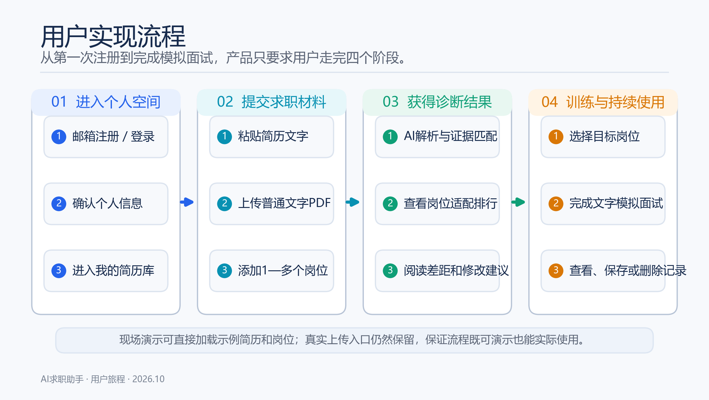
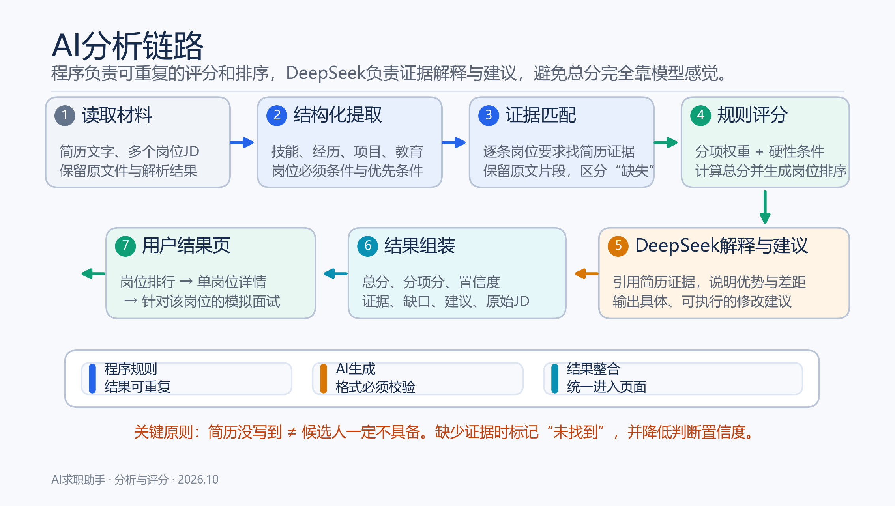
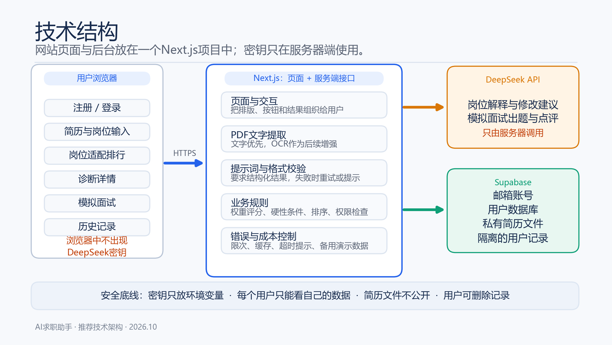
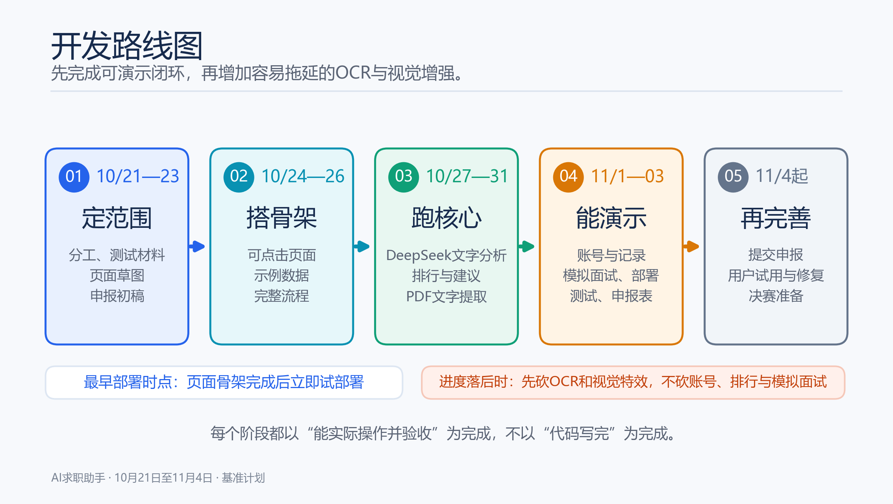
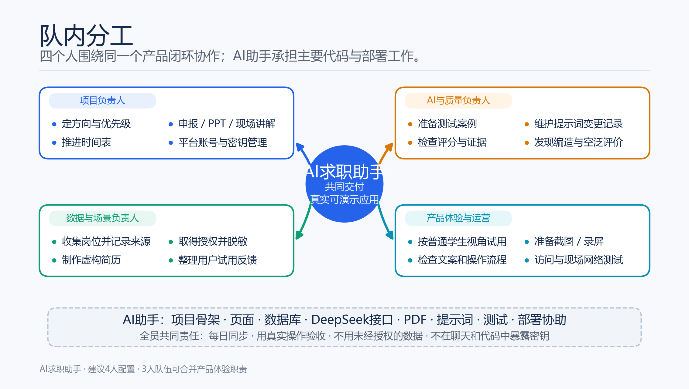
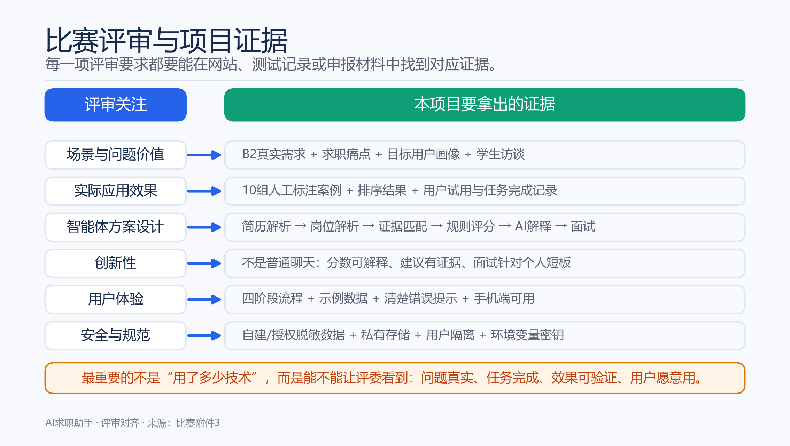
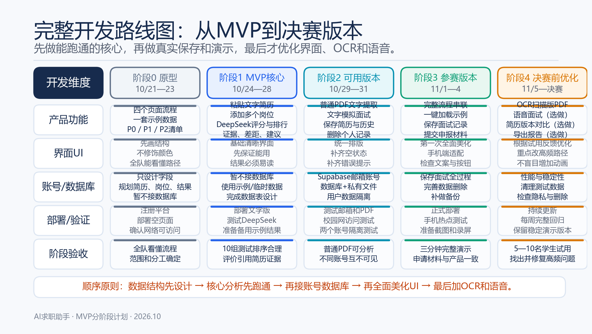

# AI求职助手：项目实施手册

> 用途：统一项目目标、开发顺序和队内分工，作为后续需求讨论、代码开发、测试和比赛申报的共同依据。  
> 更新时间：2026年10月21日  
> 参考资料：比赛通知、附件1任务清单、附件2项目申报表、附件3其他事项说明。

---

## 图示导航

每张图都提供PNG预览版和可编辑的SVG版。图片文件统一放在 `assets/diagrams/` 目录中，方便替换队名、姓名和职责。

### 图1：用户实现流程

说明用户从注册、提交材料、获得诊断到模拟面试的完整使用路径。



可编辑文件：`assets/diagrams/01-用户实现流程.svg`

### 图2：AI分析链路

说明简历和岗位如何变成分项分数、证据、差距、建议和排行，以及程序和AI各自负责什么。



可编辑文件：`assets/diagrams/02-AI分析链路.svg`

### 图3：技术结构

说明用户浏览器、Next.js后台、DeepSeek和Supabase之间的关系，以及密钥和用户数据的安全边界。



可编辑文件：`assets/diagrams/03-技术结构.svg`

### 图4：开发路线图

说明从现在到11月4日应该先做什么、后做什么，以及进度落后时必须保留的核心功能。



可编辑文件：`assets/diagrams/04-开发路线图.svg`

### 图5：队内分工

说明建议的四类队内角色、AI助手承担的工作，以及全员共同责任。



可编辑文件：`assets/diagrams/05-队内分工.svg`

### 图6：比赛评审与项目证据

说明六项评审关注点分别需要准备什么材料，避免开发完成后才发现没有留下参赛证据。



可编辑文件：`assets/diagrams/06-评审与证据.svg`

### 图7：从MVP到决赛版本的完整路线

把五个开发阶段的产品功能、界面优化、账号数据库、部署验证和验收标准放在同一张图里。



可编辑文件：`assets/diagrams/07-MVP到决赛路线图.svg`

---

## 一、一句话说明项目

AI求职助手面向郑州大学正在求职的学生。用户提交简历和一个或多个岗位的招聘要求后，系统给出岗位适配度排行、每项分数、判断依据和简历修改建议，并针对用户选中的岗位进行文字版模拟面试。

本项目对应学校真实需求清单中的：

- 任务编号：B2
- 任务名称：精准就业匹配与求职辅助（含研究生就业）
- 难度：中
- 建议规模：3—4人
- 建议技术：大模型、语义匹配、OCR
- 最低演示闭环：简历与岗位匹配排序、简历诊断报告、模拟面试对话

---

## 二、项目要解决的问题

### 1. 学生面对的问题

- 不知道自己的简历适合哪些岗位。
- 看到岗位要求后，不知道差距在哪里。
- 得到的修改建议经常很空泛，不知道具体改哪一句。
- 缺少针对目标岗位的面试练习，只能使用通用题库。
- 多份简历、多个岗位和分析结果容易散落，无法持续管理。

### 2. 学校就业服务面对的问题

- 人工简历诊断和岗位推荐耗时，难以覆盖大量学生。
- 就业指导质量依赖老师个人经验，难以保持一致。
- 缺少可追踪的学生求职准备记录和共性问题数据。

### 3. 本项目的处理方式

系统不替学生编造经历，也不直接替学生投递岗位。它把求职准备拆成三个连续步骤：

1. 看懂简历和岗位要求。
2. 用证据说明为什么匹配或不匹配。
3. 根据真实短板进行修改训练和模拟面试。

---

## 三、目标用户和使用场景

### 主要用户

- 准备实习、校招和社招的本科生。
- 准备就业的硕士研究生和博士研究生。
- 需要批量开展简历诊断和面试辅导的就业指导老师。

### 典型使用场景

- 学生从校园招聘会拿到多个岗位，想快速比较哪个更值得优先准备。
- 学生想投某个岗位，但不确定简历中的经历是否符合要求。
- 学生收到面试邀请，希望针对岗位进行模拟练习。
- 就业指导老师使用示例简历向学生展示“岗位要求—简历证据—能力差距”的分析方法。

---

## 四、用户完整使用流程

```text
邮箱注册/登录
    ↓
粘贴或上传一份简历
    ↓
粘贴一个或多个岗位招聘要求
    ↓
系统解析简历和岗位
    ↓
生成岗位适配度排行
    ↓
查看分数、匹配证据、能力差距、修改建议
    ↓
选择一个岗位进入模拟面试
    ↓
完成若干道问题并获得面试总结
    ↓
在个人历史记录中再次查看或删除数据
```

产品中的“排行”准确来说是“岗位适配度排行”。一家企业可能有多个岗位，适配度必须对应具体岗位，而不是笼统对应整个企业。

---

## 五、最终希望实现的成品

### 至少能在决赛演示的版本

- 可通过公开网址访问的完整网站。
- 支持邮箱注册、登录、退出和密码重置。
- 支持粘贴简历文字和上传普通文字版PDF。
- 支持输入或保存多个岗位。
- 生成岗位适配度排行。
- 每个岗位显示总分、分项分、匹配原因、能力差距和修改建议。
- 支持文字版模拟面试和面试总结。
- 保存用户简历、岗位、分析结果和面试记录。
- 提供一份无需现场上传文件的内置演示数据。
- 明确提示AI结果仅供求职准备参考，最终决定由用户作出。

### 后续增强版本

- 扫描版PDF的OCR文字识别。
- 语音回答问题及语音转文字。
- 简历版本对比和修改前后效果对比。
- 更细的岗位题库和行业化评分规则。
- 就业指导老师查看脱敏汇总数据的后台。
- 与学校就业平台或岗位库对接。

第一版的重点是完成一条真实、稳定的使用链路，而不是堆很多互不相连的功能。

---

## 六、比赛文件对项目提出的要求

### 1. 评审重点

| 评审内容 | 项目需要拿出的证据 |
| --- | --- |
| 场景与问题价值 | 说明学生求职中的真实痛点，并证明项目对应B2真实需求 |
| 实际应用效果 | 用一组简历和岗位展示匹配排序、诊断报告和面试训练确实能完成 |
| 智能体方案设计 | 展示简历解析、岗位解析、评分、建议、模拟面试之间的完整工作流程 |
| 创新性 | 使用“证据评分+可解释建议+针对性面试”，而不是普通聊天问答 |
| 用户体验 | 操作步骤清楚，结果易读，用户知道下一步该做什么 |
| 安全与规范 | 使用自建、模拟或授权脱敏数据，保护个人信息，不泄露密钥 |

附件3明确说明：模型规模、算力规模和技术堆叠不是主要评价依据。因此，队伍不应把时间花在制造复杂名词上，应集中证明项目解决了真实问题。

### 2. 申报和决赛要求

- 申报阶段需要填写附件2项目申报表。
- 申报表需要说明应用场景、解决的问题、主要功能、智能体方案、创新点、当前基础和预期成果。
- 决赛需要形成可演示的原型、系统或应用，并提供演示材料和效果验证。
- 鼓励使用真实用户试用、任务完成情况和效果对比证明价值。
- 报名截止时间为2026年11月4日，决赛原则上在11月底前完成。

### 3. 合规要求

- 只使用公开数据、自建数据或经过授权的脱敏数据。
- 未经授权不得获取、使用或传播学校内部敏感数据和个人信息。
- 不得在代码、截图、聊天记录或公开仓库中暴露账号、密码和密钥。
- 使用第三方模型、代码和数据集时遵守其许可与使用规范。
- 获奖不等于直接进入学校生产环境，后续仍需经过安全和业务验证。

---

## 七、产品范围

### P0：没有它就不能参赛

- 邮箱注册和登录。
- 粘贴简历文字。
- 上传普通文字版PDF。
- 输入多个岗位要求。
- 岗位适配度排行。
- 单岗位总分、分项分、原因和建议。
- 文字版模拟面试。
- 用户历史记录。
- 示例数据。
- 数据删除和安全提示。

### P1：时间允许时优先补充

- 扫描版PDF的OCR识别。
- 分析结果导出为PDF。
- 简历版本对比。
- 面试问题按难度分级。
- 面向就业指导老师的脱敏汇总页面。

### P2：决赛后再考虑

- 语音面试。
- 自动同步招聘网站岗位。
- 自动投递。
- 企业端管理后台。
- 在线支付或会员功能。

### 明确不做或暂缓

- 不批量爬取招聘网站。
- 不使用未经授权的真人简历。
- 不承诺判断证书或经历“真伪”。
- 不替用户自动生成虚假技能、项目或工作经历。
- 不把一次AI评分当成录用决定。

---

## 八、结果页应该展示什么

### 排行页

按适配度从高到低展示岗位，并包含：

- 岗位和企业名称。
- 总分。
- 匹配等级。
- 判断置信度。
- 最关键的两项优势。
- 最关键的两项差距。
- 是否通过学历、专业、年限等硬性条件。

### 单岗位详情页

建议固定展示以下内容：

1. 总分和分项分数。
2. 简历与岗位的匹配证据。
3. 没找到或证据不足的要求。
4. 硬性条件是否满足。
5. 三条最重要的简历修改建议。
6. 针对该岗位的模拟面试入口。

示例结果结构：

```text
岗位：AI产品实习生
总分：82/100
匹配等级：较高
判断置信度：中

优势：
1. 有两段AI项目经历，能够提供具体证据。
2. 简历中的数据分析经验与岗位要求相关。

差距：
1. 岗位要求用户调研经验，简历中未发现明确证据。
2. 未说明每周可实习天数。

修改建议：
1. 在项目描述中补充用户调研对象、方法和结果。
2. 明确实习时间，避免HR反复确认。
```

### 分数如何产生

不能让DeepSeek直接随意给一个总分。推荐采用下面的方式：

1. 先从简历中提取技能、项目、经历、教育、证书、时间等信息。
2. 再从岗位要求中提取必须条件和优先条件。
3. 按固定维度判断是否有证据、证据强弱和差距。
4. 由程序按照约定权重计算总分并排序。
5. 由DeepSeek负责解释证据和生成建议。

初始评审可以设置类似以下维度，但必须通过测试样例校准：

- 技能匹配：35%。
- 经历和项目：30%。
- 教育、专业和证书：15%。
- 岗位偏好和其他条件：10%。
- 简历信息完整度：10%。

学历、专业、工作年限等必须条件要单独标注。简历没有写到的信息应显示“未找到”，不能直接判成“不符合”。

---

## 九、推荐技术方案

### 选择结果

- 网站和后台：Next.js。
- 账号、数据库和文件存储：Supabase。
- 大模型：DeepSeek API。
- PDF：先提取普通PDF文字，后续再加OCR。
- 部署：使用团队指定的云平台；完整平台名称和网址确认后再做针对性配置。

### 为什么选择这套

- 网站页面和后台接口可以放在一个项目中，减少需要维护的系统数量。
- Supabase直接提供邮箱登录、数据库和私有文件存储。
- DeepSeek通过后台调用，密钥不会出现在用户浏览器中。
- 对非专业程序员来说，后续查找问题和调整页面的成本较低。

### 简单关系图

```text
用户浏览器
    ↓
网站页面（Next.js）
    ↓
网站后台接口
    ├─ 调用 DeepSeek 做分析和面试
    └─ 读写 Supabase 的账号、数据库和文件
```

### 密钥和其他安全要求

- DeepSeek Key只能放在服务器环境变量中。
- 不把密钥发给队友、写进聊天、截图、代码或公开仓库。
- 不在聊天中发送真实密码或完整密钥；需要时由项目负责人直接填入平台设置。
- 简历文件放在私有存储区，不生成永久公开链接。
- 数据库必须限制用户只能读取自己的简历、岗位和分析记录。
- 用户应能删除自己的简历、分析历史和面试记录。

### PDF和OCR处理顺序

1. 用户上传普通PDF。
2. 系统优先直接提取文字。
3. 用户检查并允许修改提取结果。
4. 有文字则进入分析。
5. 没有文字时提示用户粘贴简历文字。
6. OCR功能完成后再自动识别扫描版PDF。
7. OCR结果仍要经过用户确认，避免姓名、时间和经历识别错误。

---

## 十、提示词管理

提示词由项目组和AI助手共同维护，不能只写一句“你是资深HR”。

### 每套提示词必须具备

- 明确的角色和使用场景。
- 清楚的任务目标。
- 简历和岗位信息的边界。
- 不能编造经历的禁止条件。
- 信息缺失时的处理方式。
- 评分维度和权重。
- 必须引用简历证据。
- 固定的返回格式。
- 遇到恶意指令或不相关内容时的处理方式。

### 计划维护的提示词

- 简历信息提取提示词。
- 岗位要求提取提示词。
- 岗位适配评分提示词。
- 简历修改建议提示词。
- 模拟面试出题提示词。
- 面试追问和评分提示词。
- 面试总结提示词。

### 提示词变更记录

后续在项目中建立独立的提示词文件，并记录：

- 修改日期。
- 修改原因。
- 修改前的典型错误。
- 修改后的测试结果。
- 当前使用的模型。
- 评分规则版本。

每次发现下列问题，必须主动提醒并修正提示词：

- 评价空泛，没有引用简历内容。
- AI编造简历中没有写过的能力。
- 同一个简历和岗位得到明显不一致的分数。
- 只给结论，不解释原因。
- 建议要求用户虚构经历。
- 新增功能后，原提示词已经不适用。
- 输出格式不稳定，导致网站无法展示。

---

## 十一、模拟面试方案

### 第一版

- 使用文字问答。
- 根据选中岗位和简历证据生成6—8道问题。
- 每道题覆盖技能、项目、行为或岗位动机中的一类。
- 先显示问题和考察方向，不提前显示参考答案。
- 用户文字回答后，系统给出简要点评，并可追问一次。
- 面试结束后给出专业能力、表达清晰度、岗位匹配度和改进建议。

### 面试问题不能完全随机

问题应优先来自：

- 岗位必须要求。
- 简历中的薄弱证据。
- 简历中的项目细节。
- 学生自己选择的求职方向。

可以保留一套通用问题模板，再由DeepSeek针对岗位进行改写，避免完全自由生成造成问题重复或偏离岗位。

---

## 十二、测试数据准备

测试数据是项目效果验证的核心，需要安排专人负责。

### 1. 自建简历

制作5—8份完全虚构的简历，覆盖：

- 技术岗位强匹配。
- 文科学生投技术岗位。
- 有经历但描述模糊。
- 缺少岗位要求中的关键技能。
- 本科生和研究生。
- 普通PDF和扫描版PDF。

### 2. 获得授权的真实简历

- 找3—5位愿意参与测试的同学。
- 说明用途并取得同意。
- 删除手机号、身份证号等不必要信息。
- 不将测试简历公开传播。

### 3. 岗位信息

可以从以下渠道手动收集：

- 学校就业网和校园招聘会。
- 企业官网公开的招聘页面。
- BOSS直聘等公开招聘页面。
- 公共就业平台。

第一轮准备10—20个岗位即可。记录岗位名称、企业名称、来源网址和收集日期。不要批量爬取网站，不绕过登录、付费或访问限制。

### 4. 测试标准

至少准备10组“简历+岗位”组合，人工标出：

- 明显匹配。
- 部分匹配。
- 明显不匹配。
- 信息不足。

然后检查：

- AI的排序是否符合常识。
- 高分岗位是否有明确证据。
- 低分岗位是否能指出具体差距。
- 信息不足时是否错误地直接判为不符合。
- 修改建议是否具体、可执行、没有编造经历。
- 扫描版或排版较乱的PDF是否会给出清楚的错误提示。

### 5. 演示数据

系统内准备一组无需上传文件的示例数据。现场演示时可以直接点击加载，真实上传功能仍然保留。

---

## 十三、项目实现过程

下面是从需求到成品的推荐顺序。不要同时开工所有功能，每一步完成后先验收，再进入下一步。

### 第1步：确定范围和验收标准

产出：

- 队内统一的项目一句话说明。
- P0、P1、P2功能清单。
- 用户操作流程。
- 每个功能“做到什么程度算完成”。

完成标准：所有队员对第一版必须有什么、暂时不做什么没有分歧。

### 第2步：准备测试材料

产出：

- 3—5份虚构简历。
- 5—10个岗位信息。
- 一份人工判断的预期结果。

完成标准：即使网站还没开发，队员也能拿着这些材料讨论“什么才是合理的匹配结果”。

### 第3步：做可点击的页面骨架

产出：

- 登录页。
- 简历和岗位输入页。
- 匹配排行页。
- 单岗位详情页。
- 模拟面试页。
- 历史记录页。

第一版可以使用假数据，但操作流程必须完整。

完成标准：队员能从头到尾点完一遍，理解每个页面要显示什么。

### 第4步：跑通文字版分析

产出：

- 用户粘贴简历和岗位。
- 后台调用DeepSeek。
- 页面显示分数、原因和建议。
- 多个岗位按分数排序。

第一版每个岗位单独分析，程序负责排序。不要直接让AI一次性凭感觉给出所有排名。

完成标准：使用准备好的测试材料，能稳定生成可以展示的分析结果。

### 第5步：加入PDF文字提取

产出：

- 普通PDF上传。
- 提取文字。
- 用户确认和修改文字。
- 解析失败提示。

完成标准：普通PDF能够进入分析；扫描版PDF不会静默失败，而是给出明确提示。

### 第6步：加入账号和数据库

产出：

- 邮箱注册、登录、退出。
- 保存简历、岗位、分析和面试记录。
- 用户只能查看自己的数据。
- 用户删除数据。

完成标准：使用两个不同账号测试，彼此不能看到对方数据。

### 第7步：加入模拟面试

产出：

- 根据岗位生成问题。
- 逐题回答和简要点评。
- 面试结束总结。
- 保存面试记录。

完成标准：能从匹配报告直接进入面试，并完成一轮完整问答。

### 第8步：加入OCR

产出：

- 扫描版PDF识别。
- OCR结果确认页面。
- 识别失败重试或改用文字粘贴。

OCR排在后面，因为它容易受文件清晰度、网络服务和费用影响。核心演示不能被OCR卡住。

### 第9步：部署和现场演示准备

产出：

- 可公开访问的网站。
- 正确的环境变量。
- 内置演示账号和示例数据。
- 备用截图或录屏。
- 三分钟演示流程。

完成标准：至少在两种网络环境下测试访问和核心操作。

### 第10步：测试、修正、冻结版本

产出：

- 问题清单。
- 修复记录。
- 申报表和演示视频。
- 最终版本。

临近提交时停止增加新功能，只处理影响演示和数据安全的问题。

---

## 十四、建议时间安排

以下安排按当前距离11月4日报名截止的实际情况制定。日期是基准，不是承诺；如果进度落后，优先保留P0功能，砍掉OCR等非核心功能。


| 日期 | 目标 | 当天应拿到的结果 |
| --- | --- | --- |
| 10月21日 | 确认分工和项目范围 | 每名队员知道自己负责什么 |
| 10月22—23日 | 准备测试材料和产品流程 | 简历、岗位、预期结果、页面草图 |
| 10月24—26日 | 页面骨架和假数据 | 可以从头点到尾的演示流程 |
| 10月27—29日 | 文字版DeepSeek分析 | 分数、原因、建议和排行 |
| 10月30—31日 | PDF和账号数据库 | 能上传普通PDF并保存记录 |
| 11月1—2日 | 模拟面试和体验修正 | 完成一轮文字模拟面试 |
| 11月3日 | 完整测试和申报材料 | 修复关键问题，确定演示数据 |
| 11月4日 | 提交申报材料 | 完成学校要求的报名 |
| 11月5日至决赛前 | 用户试用和完善 | 用证据证明真实应用效果 |

每两天至少进行一次完整流程演示。不能等到所有功能都做完才第一次测试整个网站。

---

## 十五、队内分工建议

建议按4人配置。如果只有3人，可以把“产品体验与运营”合并到项目负责人。

### 1. 项目负责人

主要工作：

- 确定项目方向和最终取舍。
- 维护时间表，推动每项任务按期交付。
- 决定第一版做什么、延期什么。
- 负责比赛申报表、汇报PPT和现场讲解。
- 管理DeepSeek、Supabase和部署平台账号。
- 确认所有队员知悉数据安全要求。

验收责任：

- 项目是否完成了一条闭环。
- 申报材料是否与真实产品一致。
- 现场演示是否能控制在规定时间内。

### 2. AI与质量负责人

主要工作：

- 准备提示词测试案例。
- 检查AI评分是否合理、理由是否有证据。
- 记录提示词问题和修改过程。
- 组织人工预期结果和AI结果对比。
- 发现AI编造经历、评分不稳定或建议空泛时，及时提出修正。

验收责任：

- 10组以上测试案例的评分和排序没有明显常识错误。
- 结果中能够引用简历原文作为证据。
- 信息不足时不会冒充确定结论。

### 3. 数据与场景负责人

主要工作：

- 收集和整理岗位信息及来源。
- 制作虚构简历。
- 联系愿意试用的同学并做好脱敏。
- 管理测试数据，不随意传播个人简历。
- 整理用户试用反馈。

验收责任：

- 演示数据覆盖匹配、部分匹配和不匹配。
- 每个岗位都有来源和收集日期。
- 不使用未经授权的简历或内部数据。

### 4. 产品体验与运营负责人

主要工作：

- 按普通学生视角试用所有页面。
- 检查按钮、提示语、结果解释是否容易理解。
- 准备示例账号、截图、演示录屏和宣传材料。
- 协助完成部署平台注册、访问测试和现场网络检查。
- 维护问题清单，确认修复后关闭问题。

验收责任：

- 新用户不看说明也能完成主要操作。
- 页面没有明显错别字、空白页和卡死流程。
- 现场即使上传失败，也能使用示例数据继续演示。

### AI助手负责的工作

- 搭建网站和项目文件结构。
- 编写页面、后台接口和数据库结构。
- 接入DeepSeek和Supabase。
- 实现PDF文字提取、评分排序和历史记录。
- 编写模拟面试流程。
- 编写并持续修正提示词。
- 进行测试、修复错误和协助部署。
- 根据最新需求维护本实施手册。

### 队员必须亲自完成的工作

- 注册并保管比赛涉及的平台账号。
- 决定产品取舍并提供真实使用反馈。
- 准备测试简历、岗位信息和演示材料。
- 参加最终验收和现场演示。
- 核对申报表内容，确保所有个人信息真实准确。

AI可以承担大量代码和部署工作，但账号授权、内容真实性、队员意见和现场决策仍需要团队完成。

---

## 十六、队内协作规则

### 每次讨论新功能时

1. 先说用户要解决什么问题。
2. 再说用户如何操作。
3. 再说页面最终显示什么。
4. 最后才讨论用什么技术实现。

### 每次改变功能时

必须同时检查：

- 是否影响提示词。
- 是否影响评分标准。
- 是否影响数据库保存内容。
- 是否需要新增测试案例。
- 是否需要修改申报表或演示脚本。

### 每次提交代码前

- 至少完成一次真实操作。
- 检查是否泄露密钥。
- 检查不同账号的数据是否隔离。
- 检查错误提示是否清楚。
- 记录已知问题，不把问题藏在演示数据后面。

### 固定沟通节奏

- 每天用15分钟同步：昨天完成什么、今天做什么、遇到什么阻碍。
- 每两天完整演示一次网站。
- 所有决定写入本手册或后续需求文档，避免只在聊天里口头约定。

---

## 十七、部署准备

目前只知道部署平台名称以“cloud”开头，尚未确认完整名称。项目负责人需要尽快提供平台完整名称或网址。

部署前准备：

- DeepSeek账号和可用额度。
- Supabase项目。
- 部署平台账号。
- 邮箱服务配置。
- 网站域名或平台提供的测试网址。

环境变量建议分类保存：

```text
DEEPSEEK_API_KEY=只在服务器使用
SUPABASE_URL=可由后端和前端使用
SUPABASE_PUBLISHABLE_KEY=按平台要求使用
SUPABASE_SERVER_KEY=只在服务器使用
```

真实值不能写进本文件、代码、截图、申报表或聊天记录。

部署完成后需要测试：

- 页面能正常打开。
- 邮箱注册和登录正常。
- 粘贴文字分析正常。
- 普通PDF上传正常。
- 分析结果能保存和再次查看。
- 模拟面试能完成。
- 两个账号互相看不到对方数据。
- 手机和电脑浏览器都能完成主要操作。
- 校园网络和手机热点至少各测试一次。

---

## 十八、主要风险和应对办法

| 风险 | 影响 | 应对办法 |
| --- | --- | --- |
| DeepSeek接口超时或额度不足 | 现场无法分析 | 提前充值、限制调用次数、准备示例结果和录屏 |
| AI评分不稳定 | 评委质疑可信度 | 固定评分标准、保存评分版本、准备人工标注测试集 |
| AI编造简历经历 | 产生错误建议 | 强制引用简历证据，缺少信息写“未找到”，人工抽查 |
| PDF文字提取混乱 | 分析结果错误 | 先让用户确认文字，扫描版再做OCR |
| 云平台或校园网络不稳定 | 无法打开网站 | 尽早部署，准备手机热点、截图和录屏 |
| 真实简历涉及个人信息 | 安全和合规风险 | 优先使用虚构数据，真实数据取得授权并脱敏 |
| 功能过多做不完 | 核心流程不完整 | 严格按P0优先，最后阶段停止新增功能 |
| 队员只等AI写代码 | 需求和质量无人负责 | 每名队员按本手册承担验收和数据责任 |
| 现场只展示聊天窗口 | 不易体现应用价值 | 重点展示排行、证据、建议和面试闭环 |

---

## 十九、最终验收清单

### 产品功能

- [ ] 邮箱注册和登录可用。
- [ ] 可粘贴简历文字。
- [ ] 可上传普通文字版PDF。
- [ ] 可输入多个岗位。
- [ ] 可生成岗位适配度排行。
- [ ] 每个岗位有总分、分项分、原因、证据和建议。
- [ ] 可进入文字版模拟面试。
- [ ] 可查看和删除历史记录。
- [ ] 可一键加载示例数据。

### AI效果

- [ ] 测试案例的排序符合常识。
- [ ] 评价引用了简历中的具体内容。
- [ ] 信息不足时会明确标注。
- [ ] 修改建议没有要求用户编造经历。
- [ ] 同一组材料重复测试时，结论没有剧烈变化。

### 安全合规

- [ ] 密钥没有出现在前端代码和公开仓库。
- [ ] 用户只能访问自己的数据。
- [ ] 简历文件不是永久公开链接。
- [ ] 测试使用了自建、模拟或授权脱敏数据。
- [ ] 页面向用户说明个人信息用途和AI输出局限。

### 比赛展示

- [ ] 申报表填写完整且内容真实。
- [ ] 已准备项目简介、功能方案和创新点。
- [ ] 已准备效果验证数据和用户试用记录。
- [ ] 已准备PPT、截图和备用录屏。
- [ ] 三分钟演示能够完整走通。

---

## 二十、三分钟现场演示脚本

### 0:00—0:30 说明问题

“学生拿到多个岗位后，很难判断哪一个更适合，也不知道简历具体差在哪里。我们的AI求职助手把岗位匹配、简历诊断和面试训练连成一条流程。”

### 0:30—1:10 展示输入

登录网站，加载示例简历，选择三个岗位。说明系统读取的是简历中的真实证据，不会编造经历。

### 1:10—1:50 展示排行和依据

展示岗位排行，打开第一名岗位：

- 总分和分项分。
- 匹配证据。
- 没找到的能力。
- 三条具体修改建议。

### 1:50—2:30 展示模拟面试

针对选中岗位生成一个问题，现场回答，展示点评和追问。再展示最终面试总结。

### 2:30—2:50 展示真实应用价值

展示历史记录、数据删除和测试结果，说明系统可以帮助学生持续准备，而不是只生成一次聊天回答。

### 2:50—3:00 说明边界

“AI提供辅助分析和训练，最终求职决定由学生作出。我们使用自建或授权脱敏数据，并保护用户个人信息。”

---

## 二十一、现在就要确定的队内任务

### 今天

- [ ] 确定队长和每名队员的角色。
- [ ] 确定项目正式名称。
- [ ] 确认参赛方向选择“校园真实需求挑战”。
- [ ] 确定部署平台完整名称和网址。
- [ ] 确认DeepSeek、Supabase和部署平台由谁注册及保管。

### 两天内

- [ ] 收齐3—5份虚构简历。
- [ ] 收集5—10个岗位信息并记录来源。
- [ ] 写出至少10组测试组合。
- [ ] 确认第一版页面和功能范围。
- [ ] 完成附件2中项目简介、功能方案和创新点初稿。

### 开始开发前

- [ ] 所有队员同意P0功能清单。
- [ ] 所有队员知道哪些数据可以用于测试。
- [ ] 所有队员知道不能在聊天和代码中暴露密钥。
- [ ] 项目负责人提供部署平台和账号配置条件。

---

## 二十二、分工确认表

| 工作 | 负责人 | 替补/协作人 | 截止时间 | 状态 |
| --- | --- | --- | --- | --- |
| 项目总体推进 | 待填写 | 待填写 | 待填写 | 未开始 |
| 比赛申报与汇报 | 待填写 | 待填写 | 11月4日前 | 未开始 |
| 提示词与AI效果 | 待填写 | 待填写 | 持续进行 | 未开始 |
| 简历和岗位测试数据 | 待填写 | 待填写 | 10月23日前 | 未开始 |
| 页面体验与现场演示 | 待填写 | 待填写 | 持续进行 | 未开始 |
| 平台账号和密钥管理 | 待填写 | 待填写 | 尽快 | 未开始 |
| 用户试用和效果记录 | 待填写 | 待填写 | 决赛前 | 未开始 |
| 部署和现场网络测试 | 待填写 | 待填写 | 11月3日前 | 未开始 |

---

## 结论

项目的正确推进方式是：

```text
先明确用户问题
→ 再确定必须完成的流程
→ 准备测试材料
→ 用假数据做页面
→ 接入DeepSeek跑通文字分析
→ 加入PDF和账号
→ 加入模拟面试
→ 最后增加OCR和视觉效果
→ 提前部署、验证、冻结版本
```

项目能否打动评审，不取决于用了多少模型或工具，而取决于能否用真实案例清楚证明：

1. 学生确实存在这个问题。
2. 系统确实完成了岗位匹配和面试训练。
3. 结果有证据、可理解、可验证。
4. 用户愿意继续使用，数据和隐私得到保护。

